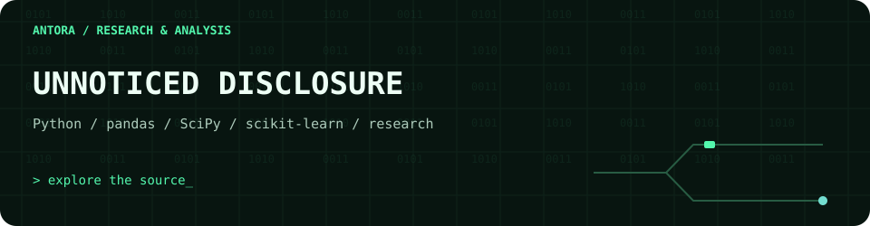

<!-- antora-terminal:start -->

  

Decorative SVG motion · matching Antora developer workspace theme · reduced-motion support
<!-- antora-terminal:end -->

# Unnoticed Disclosure

Research artifacts studying AI source-label recall and de-influencing content.

- `src/analysis.py`: scientific Python analysis using pandas, NumPy, SciPy, scikit-learn and Matplotlib.
- `paper/`: manuscript.
- `results/results.txt`: recorded results.

The script expects `responses.csv`, which is absent from the public repository. Full reproduction requires the input dataset. No publication or acceptance status is implied.
