<!-- antora-terminal:start -->
<picture>
  <source media="(prefers-reduced-motion: reduce) and (max-width: 600px)" srcset=".github/antora/workflow-mobile-still.svg">
  <source media="(prefers-reduced-motion: reduce)" srcset=".github/antora/workflow-still.svg">
  <source media="(max-width: 600px)" srcset=".github/antora/workflow-mobile.svg">
  
</picture>
Illustrative motion / responsive layout / reduced-motion alternatives
<!-- antora-terminal:end -->

# Unnoticed Disclosure

Research artifacts studying AI source-label recall and de-influencing content.

- `src/analysis.py`: scientific Python analysis using pandas, NumPy, SciPy, scikit-learn and Matplotlib.
- `paper/`: manuscript.
- `results/results.txt`: recorded results.

The script expects `responses.csv`, which is absent from the public repository. Full reproduction requires the input dataset. No publication or acceptance status is implied.
